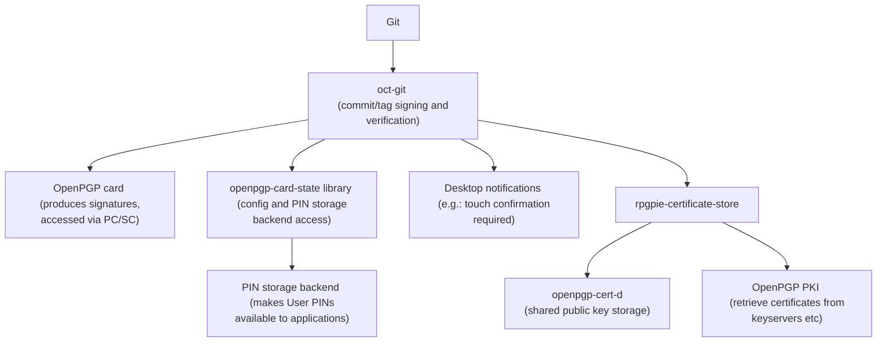

<!--
SPDX-FileCopyrightText: Wiktor Kwapisiewicz <wiktor@metacode.biz>
SPDX-FileCopyrightText: Heiko Schaefer <heiko@schaefer.name>
SPDX-License-Identifier: CC-BY-SA-4.0
-->

# OpenPGP card tool for Git signing and verification

This project provides the `oct-git` "OpenPGP card tool for Git".

`oct-git` generates (and verifies) OpenPGP signatures in the context of the [Git](https://en.wikipedia.org/wiki/Git) distributed version control system. It serves as a replacement to the `gpg` program, for use with Git.

## Why

The `oct-git` tool is a stand-alone, "no-moving-parts" solution, written in pure Rust, based on the [rPGP](https://crates.io/crates/pgp) OpenPGP library and [Rust Crypto](https://github.com/RustCrypto).
It aims for simplicity, requires no long-running processes[^pcsc], and doesn't keep a permanent connection to OpenPGP card hardware devices.

[^pcsc]: On Linux, the  `pcscd` system service is required, while on Windows and Mac, a PC/SC subsystem doesn't need to be installed (it is a part of the core system and available by default).

`oct-git` works natively on Linux, Mac and Windows. It is a new standalone solution and doesn't require (or use) any part of GnuPG.

By contrast, other tools that deal with OpenPGP tend to be complex, have many moving parts (including multiple processes, some of them long-running).

## Setup

`oct-git` is designed specifically for use with the Git version control system, as a helper to perform OpenPGP signing and verification.
Users will typically not interact directly with `oct-git`, after an initial one-time setup.

If you call `oct-git` without parameters, you'll see a very brief setup help text.

### Configuring Git to use oct-git

To use `oct-git`, Git must be configured appropriately.

Most importantly, the binary that `git` calls for OpenPGP functionality must be configured:

```sh
git config --global gpg.program <path to oct-git>
```

Additionally, the OpenPGP key that `git` should use for signing must be configured.
This value can be set to the OpenPGP fingerprint of the signing component key, or the primary fingerprint of the key:

```sh
git config --global user.signingkey <fingerprint>
```

Once this basic setup is done, `git` can be instructed to sign every commit by default: 

```sh
git config --global commit.gpgsign true
```

And/or to sign every Git tag by default:

```sh
git config --global tag.gpgsign true
```

### Switching Git's OpenPGP subsystem between oct-git and GnuPG

If you'd like to try `oct-git`, but are undecided between using it or GnuPG, once you have set up Git's OpenPGP configuration, you can always easily switch between OpenPGP Git subsystems:

You can simply call:

```sh
git config --global gpg.program <path to GnuPG>
```

or

```sh
git config --global gpg.program <path to oct-git>
```

Switching between the two alternative OpenPGP subsystems should be quick and a mostly unexciting experience.
We encourage unhesitant switching between the implementations if you want to compare them, or just play.

### Architecture and subsystems

The `oct-git` tool consists of one standalone binary, which is called by `git`, both for the creation of signatures and for the verification of signatures.

Logically, `oct-git` consists of a set of subsystems:



Most of these subsystems consist of Rust libraries that are linked into the `oct-git` program.

The following subsystems are not libraries:

- "OpenPGP card" is a physical hardware security device (often a USB device) that contains your private signing key material, to issue Git signatures with.
- An ["openpgp-cert-d"](https://crates.io/crates/openpgp-cert-d) instance consists of a set of files in a shared location in your local filesystem that contains OpenPGP certificates (public keys).
- "OpenPGP PKI" means public keyservers that serve OpenPGP certificates (public keys). This subsystem queries keyservers over the internet, to acquire copies of certificates.

### User PINs: Configuring access to OpenPGP card devices

OpenPGP card devices require a User PIN to authorize private key operations (in the case of this tool: creating cryptographic signatures for git commits).

Access to OpenPGP card User PINs is handled indirectly, using the shared [openpgp-card-state](https://crates.io/crates/openpgp-card-state) infrastructure.

If you have already stored the User PIN for your card in openpgp-card-state, it can be used from `oct-git` immediately.
Otherwise, you can store the User PIN using `oct-git`, like this:

```
$ oct-git --store-card-pin
Found OpenPGP card 0000:01234567
  No User PIN is stored in openpgp-card-state
  Enter User PIN to store (or <Enter> to skip):
  User PIN has been stored in openpgp-card-state
```

The User PIN storage process in `oct-git` is interactive. For each connected OpenPGP card device, it checks if a valid PIN is already available in `openpgp-card-state`. If not, the user is prompted for the User PIN of that card.

## Signing

`oct-git` can be used by Git to sign commits or tags.

Signing with `oct-git` requires that an OpenPGP card with the data signing key material is plugged into your system.
Additionally, the User PIN for any OpenPGP card device must be accessible via [openpgp-card-state](https://crates.io/crates/openpgp-card-state) (see above).

## Verification

Verification of signatures automatically uses OpenPGP certificates from the local [openpgp-cert-d](https://crates.io/crates/openpgp-cert-d) "shared OpenPGP Certificate Directory".

If a certificate is not present in the local openpgp-cert-d store, or hasn't been updated in a while, `oct-git` attempts to automatically download it[^lookup] from a number of well-known public online directories (currently,`oct-git` queries [keys.openpgp.org](https://keys.openpgp.org/)), [pgpkeys.eu](https://pgpkeys.eu) and [keyserver.ubuntu.com](https://keyserver.ubuntu.com/).

[^lookup]: PKI queries to acquire certificates perform a lookup by fingerprint or key id.

### Manually importing certificates to the store

You can manually import certificates into the "shared OpenPGP Certificate Directory" using `oct-git`:

```
$ oct-git --import <certificate file>
```

This can be useful if you want to verify commits by a certificate that `oct-git` can't obtain from the public OpenPGP PKI.

### Limitation: Updating certificates in the store

`oct-git` currently isn't able to update certificates in the openpgp-cert-d store. There is a [tracking issue](https://codeberg.org/heiko/rpgpie-certificate-store/issues/3) for this feature.

### Limitation: Verification "trust level"

`oct-git` currently doesn't display a "trust level" for signature verification. The "trust" concept in question is based on the *Web of Trust*, and requires configuration of "trust roots", as well as signature chains on which to perform "Web of Trust" evaluations.

This functionality [will be added in the future](https://codeberg.org/openpgp-card/oct-git/issues/2).

Until then, `oct-git` displays signatures with the "Unverified" trust level, since we don't currently have a basis for emitting more specific information.

This output means that the signature is cryptographically correct, and the fingerprint of the issuer is shown. However, no chain of trust to the signer is known.

## Internals

Technically, `oct-git` implements a lookalike for a very small subset of GnuPG's CLI interface.

Specifically, we implement just enough functionality so that Git is able to do signing and verification operations using `oct-git` instead of `gpg`.

Having a separate binary for use with Git enables `oct-git` to be a lot more specific in its user interactions. For example, when touch confirmation is required, `oct-git` will show a notification that informs the user that a touch input on a card is required, and shows that the request originates from `oct-git`.

The two following sections show how `oct-git` is called internally - usually such calls to `oct-git` are issued by the `git` program.

### Basic detached signing

```sh
oct-git -u SIGNING_KEY_FPR --detach-sign < Cargo.toml > Cargo.toml.sig
```

The `SIGNING_KEY_FPR` parameter must be set to the fingerprint of the *signing* subkey (not the certificate) in a hex-encoded format with *no* spaces (`0x` prefix is optional and removed during comparisons).

The fingerprint may be retrieved using `oct status` command.

### Signature verification

```sh
oct-git --verify Cargo.toml.sig - < Cargo.toml
```

## Software keys

Although `oct-git` is designed to work with OpenPGP Card devices it's also possible to use software keys (TSKs) by configuring the signing key with a special `file::` prefix, like so:

```sh
git config --global user.signingkey file::/home/user/path-to-key.pgp
```

Note that this feature is mostly intended for testing and because of that only keys that are not password locked/protected are supported.

## Development

Use the scripts in `utils` to test Git commands with a development build of `oct-git` without changing your configuration.
`./utils/oct-git.sh` compiles `oct-git` from source and executes it.
`./utils/git.sh` uses environment variables to configure Git and can be used to run Git commands using `./utils/oct-git.sh` as `gpg.program`.
For example:

```sh
./utils/git.sh verify-commit HEAD
```

## Future directions

The coupling of Git with the OpenPGP signing and verification subsystem is currently based on GnuPG's CLI interface.

This is not ideal, and it limits the design space for alternative OpenPGP subsystems for Git, such as `oct-git`.
In the longer term, it would be great if Git supported a more simple, generic and well-defined interface between itself and signing/verification subsystems.

This goal is currently out of scope for this project, but we'd love to hear from you, if you are working on it!

# Funding

This project has been funded in part through [NGI Assure](https://nlnet.nl/assure), a fund established by [NLnet](https://nlnet.nl) with financial support from the European Commission's [Next Generation Internet](https://ngi.eu) program.

[](https://nlnet.nl/assure)

---

🐒️🥯️
